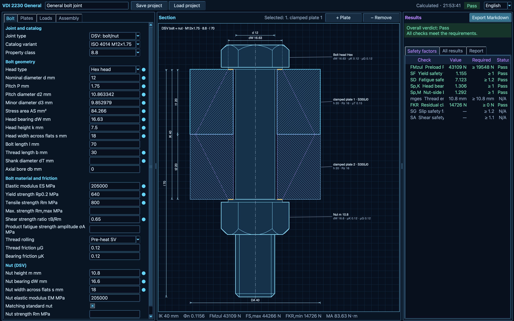
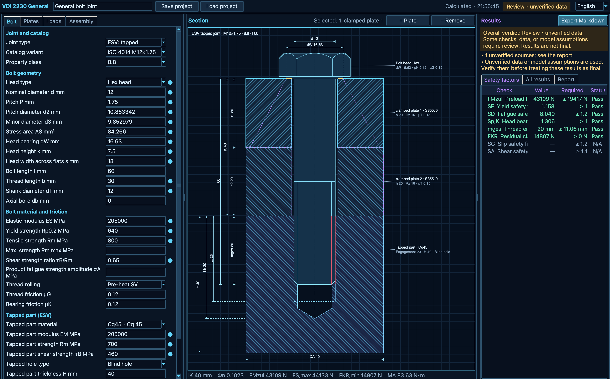

# VDI 2230 Bolt Checker

**Version 0.0.1** — An offline Python desktop application for checking
concentric single-bolt joints using VDI 2230 Part 1:2015.

Note: The program was developed largely by using of LLM.

Enter joint geometry, materials and loads to calculate safety checks, view an
interactive 2D section, and export a calculation report. No browser, server
or internet connection is needed.

## Features

- **Joint types:** through bolt with nut (DSV) and tapped thread (ESV).
- **Geometry:** 1–10 clamped plates, optional plain washers, solid/hollow and
  reduced-shank bolts, and blind/through tapped holes.
- **Bolt catalog:** ISO 4014/4017 hexagon bolts and ISO 4762 socket head screws,
  M6–M30 catalog sizes, with editable dimensions and material properties.
- **Calculations:** preload, joint compliance, strength, fatigue, bearing
  pressure, thread engagement, slip/shear and tightening torque (R1–R13).
- **Live results:** automatic recalculation, safety-check status and a clickable
  section drawing.
- **Files:** save/load designs as JSON and export reports as Markdown.
- **Languages:** English and Chinese, including reports; translation is offline.

## Screenshots

### Tapped joint (ESV)



### Through bolt with nut (DSV)



## Quick start

Requires **Python 3.10+**, **Tkinter/Tcl/Tk** and a graphical desktop.
Runtime calculations and tests use the Python standard library. Tkinter comes
from your Python distribution or operating system, not pip.

Run these commands from the project folder.

### macOS

```sh
python3 -m venv .venv
source .venv/bin/activate
python -m pip install -e .
python -m vdi2230
```

### Windows PowerShell

```powershell
py -m venv .venv
.\.venv\Scripts\Activate.ps1
python -m pip install -e .
python -m vdi2230
```

After installation, `vdi2230` also launches the application.
Use `vdi2230 --version` to check the version or `vdi2230 --help` for options.
Rerun `python -m pip install -e .` after changing branches or updating the
installation, then restart the application.

## Basic workflow

Just follow VDI 2230 PART 1.

## Scope and engineering notes

- Loads must be specified for a **single bolt**. Eccentric loading/clamping,
  bending, thermal effects, bolt-group load distribution and 3D/FEA are not covered.
  The section view is schematic, not a manufacturing drawing or stress plot.
- Catalog values are editable calculation references, not product certification.
  Confirm actual dimensions, material properties and availability.
- A2 thread-stripping checks require actual maximum bolt tensile strength;
  nonstandard nuts also require actual nut strength data. The matching-standard-nut
  option is an assumption, not nut selection or certification.
- Washer dimensions and blank tapped-hole dimensions may be estimated.
  Replace estimates with actual measurements. The plain-washer model remains
  flagged for review and does not verify washer bending or local yielding.
- This tool supports engineering review; it does not replace the official
  standard, engineering judgment or independent design verification.

## Development and tests

After installation, run:

```sh
python -m unittest discover -s tests -v
```

Tests cover calculations, catalog data, input validation, reports, project
files, translation and Tk widgets. GUI tests require Tk and a display;
skipped GUI tests do not count as desktop validation.

In VS Code, select the project Python environment and run the task
**VDI 2230: Tk UI** or **VDI 2230: All tests**.
The current validation platform is macOS; Windows still requires native testing.

## License

The project's original source code is licensed under the MIT License; see
[LICENSE](./LICENSE). This license does not replace or extend the separate
terms for third-party code, data or other materials distributed with the
project. In particular, see the [bolt catalog sources and licenses](./src/vdi2230/data/bolt_catalog/README.md)
and the license files distributed with that catalog.

## Technical documentation

- [Requirements, architecture and release validation](./SOFTWARE_SPECIFICATION.md)
- [Bolt catalog, sources and licenses](./src/vdi2230/data/bolt_catalog/README.md)
